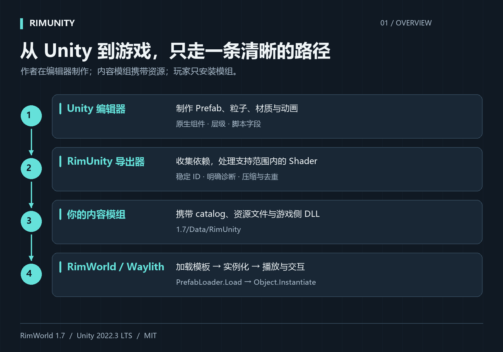
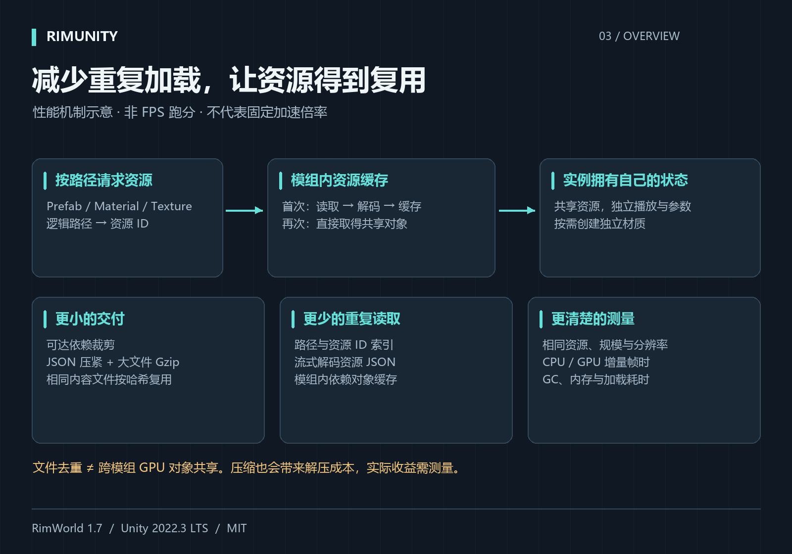
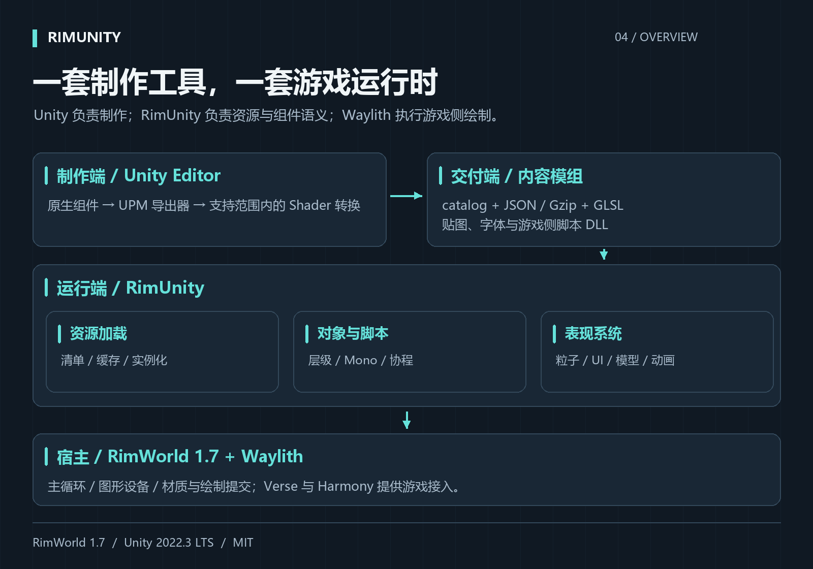

# Steam 图文简介 / Illustrated Steam description

[中文 BBCode](Description.zh-CN.bbcode.txt) · [English BBCode](Description.en.bbcode.txt)

PNG 为 1600 × 1120，中英文各四张。复制对应 BBCode 到工坊简介即可引用图片。性能图介绍优化机制，不代表实测 FPS 或固定加速倍率。

The PNGs are 1600 × 1120, with four diagrams per language. Copy the matching BBCode into the Workshop description to reference the images. The performance diagram explains mechanisms, not measured FPS or a fixed speedup.

| 图示 / Diagram | 简体中文 | English |
| --- | --- | --- |
| 工作流 / Workflow | [PNG](Images/zh-CN/workflow.png) | [PNG](Images/en/workflow.png) |
| 优势 / Advantages | [PNG](Images/zh-CN/advantages.png) | [PNG](Images/en/advantages.png) |
| 性能机制 / Performance | [PNG](Images/zh-CN/performance.png) | [PNG](Images/en/performance.png) |
| 架构 / Architecture | [PNG](Images/zh-CN/architecture.png) | [PNG](Images/en/architecture.png) |

绘图脚本 / Drawing source: [Draw-Explainers.py](../Artwork/Draw-Explainers.py)。在安装 Pillow 的 Windows Python 环境运行，使用系统微软雅黑字体。

Run the script with Python and Pillow on Windows. It uses the system Microsoft YaHei fonts.
